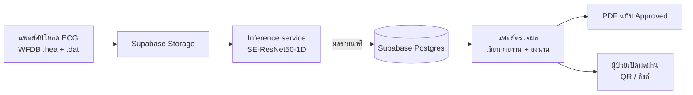
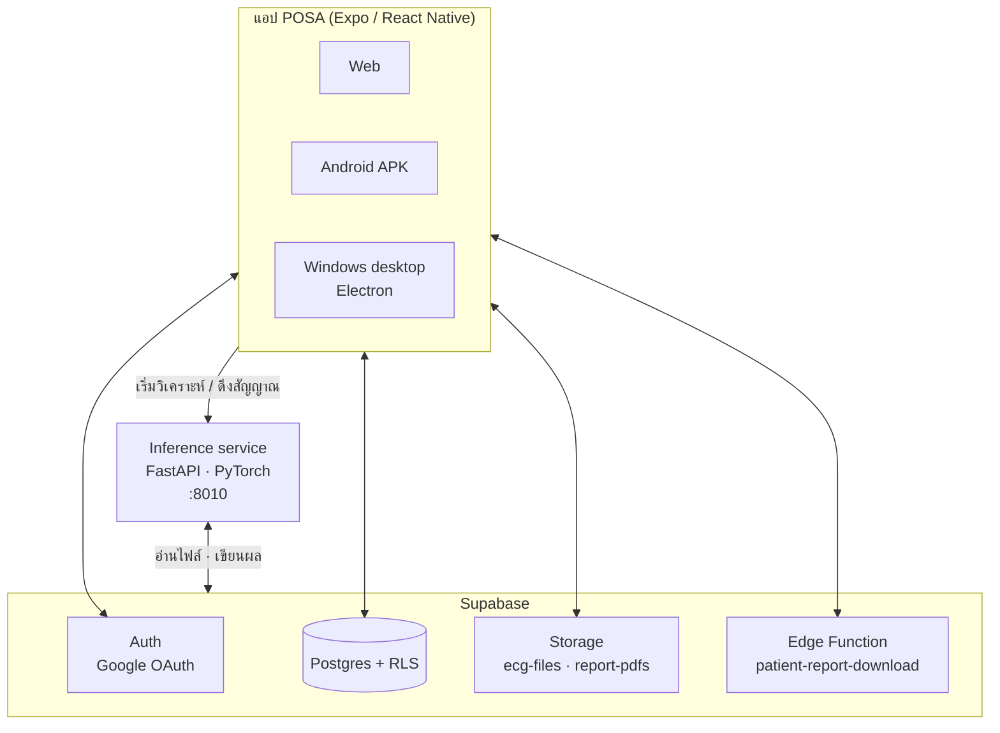

# POSA — Predictor of Obstructive Sleep Apnea

**แอปช่วยคัดกรองภาวะหยุดหายใจขณะหลับ (Obstructive Sleep Apnea, OSA) จากสัญญาณ ECG**
แพทย์อัปโหลดคลื่นไฟฟ้าหัวใจตลอดคืน → โมเดล Deep Learning วิเคราะห์ทีละนาที → แพทย์ตรวจผล เขียนรายงาน
และลงนาม → ผู้ป่วยเปิดดูผลของตัวเองผ่าน QR code หรือลิงก์

### 🎬 [ดูวิดีโอสาธิตวิธีใช้งาน (Google Drive)](https://drive.google.com/drive/folders/1AqCBWkFVapTJ-2_uzj6I95ZVFECWn7M4?usp=sharing)

> [!IMPORTANT]
> ระบบช่วยวิเคราะห์ด้วย AI เพื่อการสาธิตและการศึกษาทางวิศวกรรมชีวการแพทย์เท่านั้น
> ไม่ใช่เครื่องมือทดแทนการวินิจฉัยหรือการตัดสินใจโดยบุคลากรทางการแพทย์

---

## สารบัญ
- [ภาพรวม](#ภาพรวม)
- [ฟีเจอร์](#ฟีเจอร์)
- [สถาปัตยกรรม](#สถาปัตยกรรม)
- [Tech stack](#tech-stack)
- [โครงสร้างโปรเจกต์](#โครงสร้างโปรเจกต์)
- [การติดตั้งและรัน](#การติดตั้งและรัน)
- [การ build และ deploy](#การ-build-และ-deploy)
- [ไฟล์ข้อมูลที่รองรับ](#ไฟล์ข้อมูลที่รองรับ)
- [ความปลอดภัยและความเป็นส่วนตัว](#ความปลอดภัยและความเป็นส่วนตัว)
- [ข้อจำกัด](#ข้อจำกัด)
- [ทีมผู้พัฒนา](#ทีมผู้พัฒนา)

---

## ภาพรวม

การตรวจการนอนหลับมาตรฐาน (Polysomnography) มีราคาสูงและต้องนอนที่โรงพยาบาล POSA ทดลองใช้
**สัญญาณ ECG lead เดียว** ซึ่งเก็บง่ายกว่ามาก มาประเมินช่วงที่น่าจะเป็นภาวะหยุดหายใจ เพื่อช่วยแพทย์คัดกรองเบื้องต้น



---

## ฟีเจอร์

### 👩‍⚕️ ฝั่งแพทย์ (login ด้วย Google)
| หน้า | ทำอะไรได้ |
|---|---|
| **Home** | รายการการตรวจทั้งหมด ค้นหาและกรองตามสถานะได้ ลบแบบ soft delete พร้อมปุ่ม Undo |
| **Upload** | อัปโหลดไฟล์ WFDB อ่านค่า sampling rate และ lead จาก header ให้อัตโนมัติ ถ้ากรอกรหัสผู้ป่วยซ้ำ ระบบจะใช้ผู้ป่วยคนเดิม |
| **Processing** | ติดตามความคืบหน้าการวิเคราะห์ของโมเดล และกู้งานที่ค้างได้เมื่อ service รีสตาร์ท |
| **Detail** | ดูคลื่น ECG ทีละนาที แบบ raw / filtered พร้อม R-peak, อัตราการเต้นหัวใจ และช่วงที่โมเดลจัดเป็น apnea ไล่ดูทั้งคืนได้ และบันทึกอาการที่สังเกตระหว่างเล่นสัญญาณได้ |
| **Summary** | ผลจากโมเดล (นาทีที่วิเคราะห์ / นาทีที่เป็น apnea / สัดส่วน) และกราฟสรุปทั้งคืน |
| **Report** | เขียน *Clinician opinion* และ *Patient explanation* สถานะ Draft → Reviewed → Approved (ย้อนกลับได้) ระบบ**ลงนามด้วยชื่อจากบัญชีที่ login พร้อมเวลา** รายงานที่ Approved แล้วถูกล็อก และ**เก็บ PDF ฉบับ Approved ไว้ใน Supabase อัตโนมัติ** |
| **Patient link** | สร้าง QR code และลิงก์ Dashboard ให้ผู้ป่วย มีวันหมดอายุ |
| **Deletion log** | ดูว่าใครลบหรือกู้คืนการตรวจไหน เมื่อไหร่ ของผู้ป่วยทุกคนที่ตัวเองดูแล บันทึกนี้แก้หรือลบไม่ได้ |
| **Server status** | ตรวจสถานะการเชื่อมต่อกับ inference service |

### 🧑 ฝั่งผู้ป่วย (ไม่ต้องมีบัญชี)
- เปิดแอป → **I'm a patient** → **Scan QR** หรือ **Paste link** ที่ได้จากแพทย์
- **Dashboard ผลการนอน:** ผลทุกคืนที่ตรวจ และเมื่อแพทย์ Approve รายงานแล้ว จะเห็น AHI โดยประมาณ, ระดับความรุนแรง และ**ข้อความจากแพทย์**

- **สลับภาษาไทย / อังกฤษ**ได้ และดาวน์โหลดรายงาน PDF ฉบับ Approved ได้
- ระบบไม่แสดงชื่อ รหัสภายใน หรือความเห็นของแพทย์ (Clinician opinion) ให้ผู้ป่วยเห็น

### 🧠 โมเดล ML
- สถาปัตยกรรม **SE-ResNet50-1D** (1D ResNet + Squeeze-and-Excitation)
- รับ ECG ที่ **100 Hz** เป็นหน้าต่างละ **60 วินาที** แล้วจัดแต่ละนาทีเป็น apnea / normal ที่ threshold 0.5
- เทรนด้วยชุดข้อมูล **PhysioNet Apnea-ECG** (label รายนาที)
- หา R-peak จาก QRS annotation (ถ้ามี) หรือใช้อัลกอริทึม XQRS

---

## สถาปัตยกรรม



**Inference API** (`inference/service.py`)

| Method | Path | หน้าที่ |
|---|---|---|
| GET | `/health`, `/v1/health` | ตรวจสถานะ service |
| POST | `/v1/studies/{upload_id}/analysis` | เริ่มวิเคราะห์การตรวจ (ทำงานเบื้องหลัง) |
| GET | `/v1/studies/{upload_id}/signal` | ดึงสัญญาณ ECG รายนาทีสำหรับหน้า Detail |
| GET | `/v1/studies/{upload_id}/timeline` | ข้อมูล timeline ทั้งคืน |
| GET / POST | `/v1/studies/{upload_id}/summary` | สร้าง / อ่านสรุปทั้งคืน |
| GET | `/v1/studies/{upload_id}/diagnostics` | ข้อมูลวินิจฉัยปัญหาของงานวิเคราะห์ |

---

## Tech stack

| ส่วน | เทคโนโลยี |
|---|---|
| แอป | Expo SDK 57, React Native, `expo-router`, TypeScript |
| Desktop | Electron + electron-builder (Windows installer) |
| Backend | Supabase: Postgres, Row Level Security, Auth (Google OAuth), Storage, Edge Functions |
| ML service | Python, FastAPI, Uvicorn, PyTorch, NumPy, SciPy, `wfdb`, Matplotlib |
| PDF | `expo-print` (มือถือ), `html2pdf.js` (เว็บ) |
| QR | `expo-camera` (สแกน), `react-native-qrcode-svg` (สร้าง) |

---

## โครงสร้างโปรเจกต์

```
POSA/
├── src/
│   ├── app/                 หน้าจอ (expo-router): home, upload, processing, detail, summary,
│   │                        activity (deletion log), p/[token] (dashboard ผู้ป่วย), shared/[token], auth
│   ├── components/          UI, ECG monitor, รายงาน PDF, หน้าจอฝั่งผู้ป่วย
│   └── lib/                 Supabase client, auth, queries, inference client, offline cache
├── inference/               Inference service (FastAPI + โมเดล PyTorch)
├── supabase/
│   ├── migrations/          schema, RLS และฟังก์ชันในฐานข้อมูลทั้งหมด
│   └── functions/           Edge Functions
├── desktop/                 แอป Windows (Electron)
├── app.json · eas.json      ตั้งค่า Expo และการ build Android
└── vercel.json              ตั้งค่า deploy เว็บ
```

---

## การติดตั้งและรัน

### สิ่งที่ต้องมี
- **Node.js 24 LTS** (หรือ 22 LTS) และ npm
- **Python 3** สำหรับ inference service
- โปรเจกต์ **Supabase** และ OAuth client ของ **Google Cloud**
- ไฟล์ checkpoint ของโมเดลที่เทรนแล้ว (ขอได้จากทีม ML ไม่ได้อยู่ใน repo)

### 1. ติดตั้ง dependencies ของแอป
```bash
git clone https://github.com/wincpv2/POSA.git
cd POSA
npm install
```

### 2. ตั้งค่า environment ของแอป
คัดลอก `.env.example` เป็น `.env` แล้วใส่ค่า:
```
EXPO_PUBLIC_SUPABASE_URL=https://<project-ref>.supabase.co
EXPO_PUBLIC_SUPABASE_PUBLISHABLE_KEY=<publishable / anon key>
EXPO_PUBLIC_INFERENCE_API_URL=http://127.0.0.1:8010
```
> ในแอปใช้แค่ publishable key คู่กับ RLS **ห้ามใส่ `service_role` key ในแอปเด็ดขาด**
> และห้าม commit ไฟล์ `.env` (ไฟล์นี้ถูก ignore ไว้แล้ว)

### 3. ตั้งค่า Supabase
```bash
npx supabase login
npx supabase link --project-ref <project-ref>
npx supabase db push
```
- **Authentication → Providers → Google:** ใส่ Client ID / Secret จาก Google Cloud Console
- **Authentication → URL Configuration → Redirect URLs:** เพิ่ม `posaapp://auth/callback`
  และ URL ของเว็บที่ใช้ (เช่น `http://localhost:8081/**`)
- Deploy Edge Function: `npx supabase functions deploy patient-report-download`

### 4. รัน inference service
```bash
cd inference
python -m venv .venv
.venv\Scripts\activate            # macOS / Linux: source .venv/bin/activate
pip install -r requirements.txt
pip install torch                 # เลือก wheel ที่รองรับ CUDA ได้ถ้าต้องการใช้ GPU
```
คัดลอก `inference/.env.example` เป็น `inference/.env`:
```
POSA_MODEL_PATH=<path ไปยังไฟล์ checkpoint ของโมเดล>
SUPABASE_URL=https://<project-ref>.supabase.co
SUPABASE_PUBLISHABLE_KEY=<publishable key>
SUPABASE_SERVICE_ROLE_KEY=<service role key>   # ใช้ฝั่ง server เท่านั้น
```
จากโฟลเดอร์หลักของโปรเจกต์:
```bash
python -m uvicorn inference.service:app --host 127.0.0.1 --port 8010
```
บน Windows ใช้ `inference/start_server.ps1` เพื่อรันเบื้องหลังได้ (log อยู่ที่ `%LOCALAPPDATA%\POSA`)
และเช็กว่า service ทำงานด้วย `http://127.0.0.1:8010/health`

### 5. รันแอป
```bash
npm run web            # เปิดบนเว็บ
npm run android        # Android (Expo)
npm run desktop:dev    # แอป Windows (Electron)
```
> ถ้า PowerShell ขึ้น error เรื่อง execution policy ให้ใช้ `npx.cmd` / `npm.cmd` แทน

ตรวจโค้ดก่อน commit:
```bash
npx tsc --noEmit
npx expo lint
```

---

## การ build และ deploy

| เป้าหมาย | คำสั่ง / วิธี |
|---|---|
| **Android APK** | `npx eas-cli build --platform android --profile preview` (profile `preview` ใน `eas.json` สร้างไฟล์ `.apk`) |
| **Windows** | `npm run desktop:build` (สร้าง installer NSIS ใน `desktop/`) |
| **Web** | `npx expo export --platform web` แล้ว deploy ผ่าน Vercel (`vercel.json`) |

หลัง deploy เว็บ อย่าลืมเพิ่ม URL ของเว็บใน Supabase → Redirect URLs

---

## ไฟล์ข้อมูลที่รองรับ
- **WFDB:** ไฟล์ header `.hea` คู่กับไฟล์สัญญาณ `.dat` ชื่อเดียวกัน
- สัญญาณ ECG ต้องสุ่มที่ **100 Hz** (ตรงกับที่โมเดลเทรนมา)
- ตัวอย่างข้อมูลทดสอบ: [PhysioNet Apnea-ECG Database](https://physionet.org/content/apnea-ecg/)

---

## ความปลอดภัยและความเป็นส่วนตัว
- **Row Level Security ทุกตาราง:** แพทย์เห็นเฉพาะผู้ป่วยที่ตัวเองดูแล และแพทย์ที่ดูแลผู้ป่วยคนเดียวกันเห็นประวัติร่วมกันได้
- **ไม่เก็บชื่อผู้ป่วย:** ใช้รหัสแทน (de-identified)
- **ไฟล์ ECG และ PDF อยู่ใน bucket แบบ private:** ดาวน์โหลดผ่านลิงก์ชั่วคราวเท่านั้น
- **ผู้ป่วยไม่มีบัญชี:** เข้าถึงผ่าน token สุ่มยาว 64 ตัวอักษรที่มีวันหมดอายุ และได้เฉพาะข้อมูลที่จำเป็น
- **การลงนามปลอมไม่ได้:** ชื่อและเวลาลงนามถูกบันทึกโดยฐานข้อมูลจากบัญชีที่ login
- **Soft delete + audit log:** ข้อมูลไม่ถูกลบจริง ทุกการลบและกู้คืนถูกบันทึกไว้
- **`service_role` key ใช้เฉพาะใน inference service** ไม่อยู่ในแอป

---

## ข้อจำกัด
- **เป็นเครื่องมือเพื่อการศึกษา** ผลจากโมเดลต้องให้แพทย์ตีความเสมอ
- ใช้ **ECG lead เดียว** จึง**ไม่มีค่า SpO₂ / ODI** (ต้องใช้เครื่องวัดออกซิเจน) และแยกชนิดของ apnea
  (obstructive / central / mixed) หรือ hypopnea ได้ไม่ชัดเท่า Polysomnography
- โมเดลให้ผลเป็น**รายนาที** ค่า AHI ที่แสดงจึงเป็น**ค่าประมาณ**
- ตอนนี้รองรับเฉพาะไฟล์ WFDB ที่ 100 Hz

---

## ทีมผู้พัฒนา

| บทบาท | ชื่อ |
|---|---|
| UI/UX Designer | Pisit Pipathanabenjakul |
| Researcher | Papangkorn Bennarong |
| ML Engineer | Worraprach Srirattananon |
| Mobile App Developer (frontend ↔ backend, storage / database) | Panut Anan ([@tonnow2005](https://github.com/tonnow2005)) |

---

<sub>POSA · โครงงานวิศวกรรมชีวการแพทย์ · 2026</sub>
