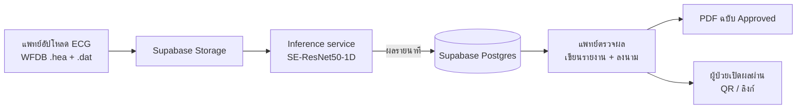
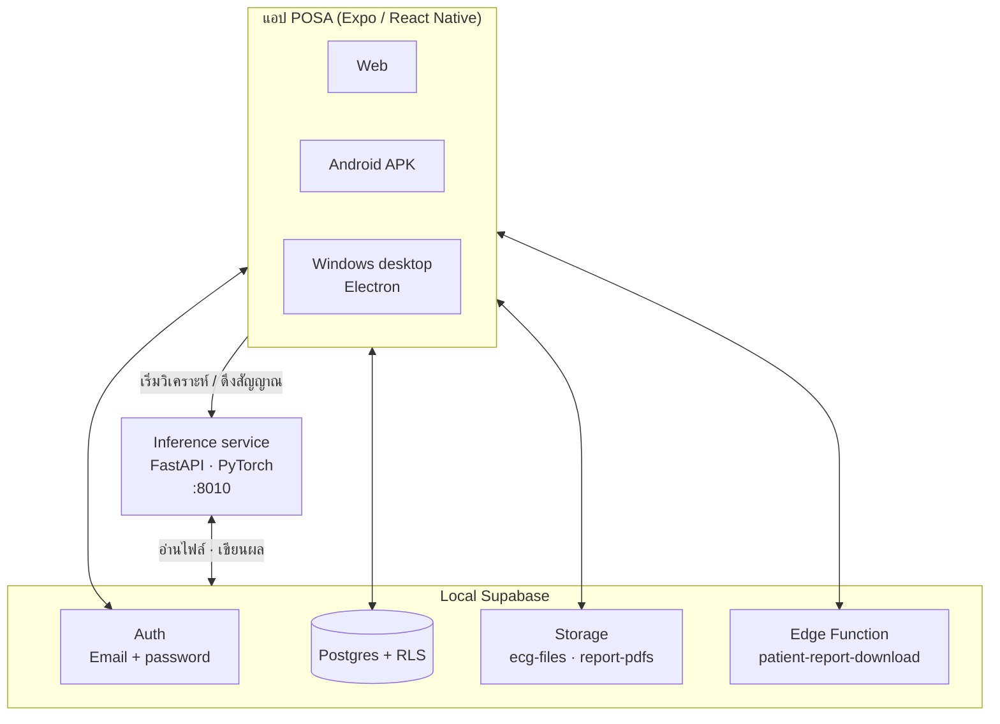

# POSA — Predictor of Obstructive Sleep Apnea

**แอปช่วยคัดกรองภาวะหยุดหายใจขณะหลับ (Obstructive Sleep Apnea, OSA) จากสัญญาณ ECG**
แพทย์อัปโหลดคลื่นไฟฟ้าหัวใจตลอดคืน → โมเดล Deep Learning วิเคราะห์ทีละนาที → แพทย์ตรวจผล เขียนรายงาน
และลงนาม → ผู้ป่วยเปิดดูผลของตัวเองผ่าน QR code หรือลิงก์

### 🎬 [ดูวิดีโอสาธิตวิธีใช้งาน (Google Drive)](https://drive.google.com/drive/folders/1AqCBWkFVapTJ-2_uzj6I95ZVFECWn7M4?usp=sharing)

> [!IMPORTANT]
> ระบบช่วยวิเคราะห์ด้วย AI เพื่อการสาธิตและการศึกษาทางวิศวกรรมชีวการแพทย์เท่านั้น
> ไม่ใช่เครื่องมือทดแทนการวินิจฉัยหรือการตัดสินใจโดยบุคลากรทางการแพทย์

## ใช้งานเว็บและวิเคราะห์ ECG

รุ่นนี้รันเว็บ ฐานข้อมูล และระบบจัดเก็บไฟล์บนเครื่องของคุณเอง เริ่มจาก [การติดตั้งและรัน](#การติดตั้งและรัน) แล้วเลือก **I'm a clinician → Create a local account** เพื่อสมัครด้วยอีเมลส่วนตัวและรหัสผ่าน
ระบบวิเคราะห์ ECG ใช้ Python inference service และไฟล์ checkpoint บนเครื่องเดียวกัน

---

## สารบัญ
- [ใช้งานเว็บและวิเคราะห์ ECG](#ใช้งานเว็บและวิเคราะห์-ecg)
- [ภาพรวม](#ภาพรวม)
- [ฟีเจอร์](#ฟีเจอร์)
- [สถาปัตยกรรม](#สถาปัตยกรรม)
- [Tech stack](#tech-stack)
- [โครงสร้างโปรเจกต์](#โครงสร้างโปรเจกต์)
- [การติดตั้งและรัน](#การติดตั้งและรัน)
- [การ build](#การ-build)
- [ไฟล์ข้อมูลที่รองรับ](#ไฟล์ข้อมูลที่รองรับ)
- [ความปลอดภัยและความเป็นส่วนตัว](#ความปลอดภัยและความเป็นส่วนตัว)
- [ข้อจำกัด](#ข้อจำกัด)
- [ทีมผู้พัฒนา](#ทีมผู้พัฒนา)

---

## ภาพรวม

การตรวจการนอนหลับมาตรฐาน (Polysomnography) มีราคาสูงและต้องนอนที่โรงพยาบาล POSA ทดลองใช้
**สัญญาณ ECG lead เดียว** ซึ่งเก็บง่ายกว่ามาก มาประเมินช่วงที่น่าจะเป็นภาวะหยุดหายใจ เพื่อช่วยแพทย์คัดกรองเบื้องต้น



---

## ฟีเจอร์

### 👩‍⚕️ ฝั่งแพทย์ (login ด้วย Google)
| หน้า | ทำอะไรได้ |
|---|---|
| **Home** | รายการการตรวจทั้งหมด ค้นหาและกรองตามสถานะได้ ลบแบบ soft delete พร้อมปุ่ม Undo |
| **Upload** | อัปโหลดไฟล์ WFDB อ่านค่า sampling rate และ lead จาก header ให้อัตโนมัติ ถ้ากรอกรหัสผู้ป่วยซ้ำ ระบบจะใช้ผู้ป่วยคนเดิม |
| **Processing** | ติดตามความคืบหน้าการวิเคราะห์ของโมเดล และกู้งานที่ค้างได้เมื่อ service รีสตาร์ท |
| **Detail** | ดูคลื่น ECG ทีละนาที แบบ raw / filtered พร้อม R-peak, อัตราการเต้นหัวใจ และช่วงที่โมเดลจัดเป็น apnea ไล่ดูทั้งคืนได้ และบันทึกอาการที่สังเกตระหว่างเล่นสัญญาณได้ |
| **Summary** | ผลจากโมเดล (นาทีที่วิเคราะห์ / นาทีที่เป็น apnea / สัดส่วน) และกราฟสรุปทั้งคืน |
| **Report** | เขียน *Clinician opinion* และ *Patient explanation* สถานะ Draft → Reviewed → Approved (ย้อนกลับได้) ระบบ**ลงนามด้วยชื่อจากบัญชีที่ login พร้อมเวลา** รายงานที่ Approved แล้วถูกล็อก และ**เก็บ PDF ฉบับ Approved ไว้ใน Supabase อัตโนมัติ** |
| **Patient link** | สร้าง QR code และลิงก์ Dashboard ให้ผู้ป่วย มีวันหมดอายุ |
| **Deletion log** | ดูว่าใครลบหรือกู้คืนการตรวจไหน เมื่อไหร่ ของผู้ป่วยทุกคนที่ตัวเองดูแล บันทึกนี้แก้หรือลบไม่ได้ |
| **Server status** | ตรวจสถานะการเชื่อมต่อกับ inference service |

### 🧑 ฝั่งผู้ป่วย (ไม่ต้องมีบัญชี)
- เปิดแอป → **I'm a patient** → **Scan QR** หรือ **Paste link** ที่ได้จากแพทย์
- **Dashboard ผลการนอน:** ผลทุกคืนที่ตรวจ และเมื่อแพทย์ Approve รายงานแล้ว จะเห็น AHI โดยประมาณ, ระดับความรุนแรง และ**ข้อความจากแพทย์**

- **สลับภาษาไทย / อังกฤษ**ได้ และดาวน์โหลดรายงาน PDF ฉบับ Approved ได้
- ระบบไม่แสดงชื่อ รหัสภายใน หรือความเห็นของแพทย์ (Clinician opinion) ให้ผู้ป่วยเห็น

### 🧠 โมเดล ML
- สถาปัตยกรรม **SE-ResNet50-1D** (1D ResNet + Squeeze-and-Excitation)
- รับ ECG ที่ **100 Hz** เป็นหน้าต่างละ **60 วินาที** แล้วจัดแต่ละนาทีเป็น apnea / normal ที่ threshold 0.5
- เทรนด้วยชุดข้อมูล **PhysioNet Apnea-ECG** (label รายนาที)
- หา R-peak จาก QRS annotation (ถ้ามี) หรือใช้อัลกอริทึม XQRS

---

## สถาปัตยกรรม



**Inference API** (`inference/service.py`)

| Method | Path | หน้าที่ |
|---|---|---|
| GET | `/health`, `/v1/health` | ตรวจสถานะ service |
| POST | `/v1/studies/{upload_id}/analysis` | เริ่มวิเคราะห์การตรวจ (ทำงานเบื้องหลัง) |
| GET | `/v1/studies/{upload_id}/signal` | ดึงสัญญาณ ECG รายนาทีสำหรับหน้า Detail |
| GET | `/v1/studies/{upload_id}/timeline` | ข้อมูล timeline ทั้งคืน |
| GET / POST | `/v1/studies/{upload_id}/summary` | สร้าง / อ่านสรุปทั้งคืน |
| GET | `/v1/studies/{upload_id}/diagnostics` | ข้อมูลวินิจฉัยปัญหาของงานวิเคราะห์ |

---

## Tech stack

| ส่วน | เทคโนโลยี |
|---|---|
| แอป | Expo SDK 57, React Native, `expo-router`, TypeScript |
| Desktop | Electron + electron-builder (Windows installer) |
| Backend | Supabase CLI + Docker: Postgres, Row Level Security, Auth (email + password), Storage, Edge Functions |
| ML service | Python, FastAPI, Uvicorn, PyTorch, NumPy, SciPy, `wfdb`, Matplotlib |
| PDF | `expo-print` (มือถือ), `html2pdf.js` (เว็บ) |
| QR | `expo-camera` (สแกน), `react-native-qrcode-svg` (สร้าง) |

---

## โครงสร้างโปรเจกต์

```
POSA/
├── src/
│   ├── app/                 หน้าจอ (expo-router): home, upload, processing, detail, summary,
│   │                        activity (deletion log), p/[token] (dashboard ผู้ป่วย), shared/[token]
│   ├── components/          UI, ECG monitor, รายงาน PDF, หน้าจอฝั่งผู้ป่วย
│   └── lib/                 Supabase client, auth, queries, inference client, offline cache
├── inference/               Inference service (FastAPI + โมเดล PyTorch)
├── supabase/
│   ├── migrations/          schema, RLS และฟังก์ชันในฐานข้อมูลทั้งหมด
│   └── functions/           Edge Functions
├── desktop/                 แอป Windows (Electron)
└── app.json · eas.json      ตั้งค่า Expo และการ build Android
```

---

## การติดตั้งและรัน

### Browse the local Apnea-ECG ZIP

Archive mode uses the original POSA Home, Detail, and Summary screens without Docker or a model checkpoint. The 70 ECG records are mapped into the study list. The signal service reads raw or filtered ECG, QRS markers, and reference apnea annotations from the ZIP. Uploads from the original POSA Upload screen are saved in `data/<study-id>/`, with patient and study metadata in `data/posa.sqlite3`. These files persist when the server restarts. The local service loads `model/se_resnet50_epoch_05.pt` when analysis starts. **Upload and analyze** starts a background job automatically, and **Run local model** on Detail analyzes an existing recording. Minute probabilities and progress are saved in the same SQLite database. The service uses CUDA when available and falls back to CPU. [PhysioNet Apnea-ECG Database](https://physionet.org/content/apnea-ecg/1.0.0/)

From the project root in PowerShell:

```powershell
npm ci
$env:EXPO_PUBLIC_POSA_DATASET_MODE = '1'
npx expo export --platform web --output-dir .expo/dataset-web
Remove-Item Env:EXPO_PUBLIC_POSA_DATASET_MODE
python -m venv .expo/dataset-venv
./.expo/dataset-venv/Scripts/python.exe -m pip install "wfdb>=4.2,<5" torch matplotlib scipy
./.expo/dataset-venv/Scripts/python.exe -m inference.local_dataset `
  apnea-ecg-data-20261125T102711Z-1-001.zip --web-dir .expo/dataset-web
```

Open `http://127.0.0.1:8081`. The server loads signal files from the ZIP as you select a recording or channel. Stop it with `Ctrl+C` before running the standard app on the same port, or set `--port` to use another local port for the dataset view.

### สิ่งที่ต้องมี
- **Node.js 24 LTS** (หรือ 22 LTS) และ npm
- **Docker Desktop** ที่กำลังทำงาน (หรือ Docker-compatible runtime) สำหรับฐานข้อมูลและบริการในเครื่อง
- **Python 3** และไฟล์ checkpoint `.pt` ของโมเดลที่เทรนแล้วสำหรับวิเคราะห์ ECG (ขอไฟล์ได้จากทีม ML)

### 1. เริ่มฐานข้อมูลในเครื่อง

จากโฟลเดอร์หลักของโปรเจกต์:

```bash
npx --yes supabase start
```

Supabase CLI สร้างฐานข้อมูลและ buckets ใน Docker และใช้ migrations ใน `supabase/migrations/` อัตโนมัติเมื่อเริ่มฐานข้อมูลใหม่ เปิด Studio ได้ที่ `http://127.0.0.1:54323` และเรียก `npx --yes supabase status` เพื่อดู Publishable key (หรือ legacy `anon` key) ของเครื่องนี้
ถ้าเคยเริ่ม stack ชื่อ `posa-local` แล้ว ให้รัน `npx --yes supabase migration up --local` เพื่อใช้ migrations ที่เพิ่มมา

### 2. เริ่มเว็บและสร้างบัญชี

คัดลอก `.env.example` เป็น `.env` แล้วใส่ Publishable key ใน `EXPO_PUBLIC_POSA_DATABASE_PUBLISHABLE_KEY` URL เริ่มต้นชี้ไปที่ฐานข้อมูล `127.0.0.1:54321` และ inference API `127.0.0.1:8010`

```bash
npm ci
npm run web -- --localhost --port 8081
```

เปิด `http://127.0.0.1:8081` เลือก **I'm a clinician → Create a local account** ใส่ชื่อ อีเมล และรหัสผ่านอย่างน้อย 8 ตัวอักษร ระบบจะเข้าสู่บัญชีทันทีและไม่ส่งอีเมลยืนยัน จากนั้นใช้บัญชีเดิมผ่าน **Sign in**
เก็บ stack ไว้บนเครื่องที่เชื่อถือได้ เพราะบัญชี clinician ใน stack เดียวกันอ่านผลการตรวจร่วมกันตามสิทธิ์ของแอป

Windows desktop ใช้เว็บในเครื่องที่ URL เดียวกัน เปิดอีก terminal แล้วรัน `npm run desktop:dev`
หากทดสอบด้วย Android Emulator ให้เปลี่ยน hostname ของ URL ทั้งสองรายการใน `.env` เป็น `10.0.2.2` แล้วรัน `npm run android`

### 3. รัน inference service สำหรับวิเคราะห์ ECG

ใช้คำสั่งต่อไปนี้จากโฟลเดอร์หลัก:

```bash
python -m venv inference/.venv
./inference/.venv/Scripts/python.exe -m pip install -r inference/requirements.txt torch
```

คัดลอก `inference/.env.example` เป็น `inference/.env` ตั้ง `POSA_MODEL_PATH` เป็น path ของไฟล์ `.pt` แล้วใส่ legacy `service_role` key ของ local stack ใน `POSA_DATABASE_SERVICE_ROLE_KEY` เรียก `npx --yes supabase status -o env` เพื่อดู `SERVICE_ROLE_KEY` และเก็บ key นี้ใน `inference/.env` เท่านั้น

```bash
./inference/.venv/Scripts/python.exe -m uvicorn inference.service:app --host 127.0.0.1 --port 8010
```

บน macOS / Linux ใช้ `inference/.venv/bin/python` แทน บน Windows ใช้ `inference/start_server.ps1` เพื่อรันเบื้องหลังได้ (log อยู่ที่ `%LOCALAPPDATA%\POSA`) ตรวจสถานะได้ที่ `http://127.0.0.1:8010/health`

> ถ้า PowerShell ขึ้น error เรื่อง execution policy ให้ใช้ `npx.cmd` / `npm.cmd` แทน

### 4. เพิ่มข้อมูลใหม่

ใน POSA เปิด **Upload** เลือกไฟล์ ECG คู่ `.hea` และ `.dat` ที่ชื่อเดียวกัน แล้วใส่รหัสผู้ป่วยแบบไม่ระบุตัวตน ระบบจะค้นหาหรือสร้างรายการผู้ป่วยจากรหัสนั้น ข้อมูลผู้ป่วย ไฟล์ ECG ผลวิเคราะห์ และ PDF ที่บันทึกจะอยู่ใน local stack ฐานข้อมูลเริ่มต้นว่างสำหรับข้อมูลของคุณเอง
ลิงก์ผู้ป่วยระบุที่อยู่ของ POSA ในเครื่อง จึงใช้ได้จากเบราว์เซอร์ที่เข้าถึงเครื่องนี้ผ่าน URL ท้องถิ่นเดียวกัน

ใช้ `npx --yes supabase stop` เพื่อหยุด stack โดยเก็บข้อมูลไว้ใน Docker และใช้ `npx --yes supabase start` เพื่อกลับมาใช้งาน

### ตรวจสอบการติดตั้ง

- `npx --yes supabase test db` ตรวจสิทธิ์บัญชีอีเมลในฐานข้อมูลท้องถิ่น
- `npm run lint` และ `npx tsc --noEmit` ตรวจโค้ดแอป
- `python -m unittest inference.test_local_settings` ตรวจการตั้งค่า inference จาก Python environment ที่ติดตั้ง dependencies แล้ว

---

## การ build

| เป้าหมาย | คำสั่ง / วิธี |
|---|---|
| **Android APK** | `npx eas-cli build --platform android --profile preview` (profile `preview` ใน `eas.json` สร้างไฟล์ `.apk`) |
| **Windows** | `npm run desktop:build` (สร้าง installer NSIS ใน `desktop/`) |
| **Web** | `npx expo export --platform web` สร้างไฟล์ใน `dist/` สำหรับเสิร์ฟผ่านเว็บเซิร์ฟเวอร์ในเครื่อง |

---

## ไฟล์ข้อมูลที่รองรับ
- **WFDB:** ไฟล์ header `.hea` คู่กับไฟล์สัญญาณ `.dat` ชื่อเดียวกัน
- สัญญาณ ECG ต้องสุ่มที่ **100 Hz** (ตรงกับที่โมเดลเทรนมา)
- ตัวอย่างข้อมูลทดสอบ: [PhysioNet Apnea-ECG Database](https://physionet.org/content/apnea-ecg/)

---

## ความปลอดภัยและความเป็นส่วนตัว
- **Row Level Security:** บัญชี clinician ใน stack เดียวกันอ่านผลการตรวจที่ยังใช้งานอยู่ได้ การแก้ไขข้อมูลการตรวจจำกัดให้เจ้าของรายการ
- **ไม่เก็บชื่อผู้ป่วย:** ใช้รหัสแทน (de-identified)
- **ไฟล์ ECG และ PDF อยู่ใน bucket แบบ private:** ดาวน์โหลดผ่านลิงก์ชั่วคราวเท่านั้น
- **ผู้ป่วยไม่มีบัญชี:** เข้าถึงผ่าน token สุ่มยาว 64 ตัวอักษรที่มีวันหมดอายุ และได้เฉพาะข้อมูลที่จำเป็น
- **การลงนามปลอมไม่ได้:** ชื่อและเวลาลงนามถูกบันทึกโดยฐานข้อมูลจากบัญชีที่ login
- **Soft delete + audit log:** ข้อมูลไม่ถูกลบจริง ทุกการลบและกู้คืนถูกบันทึกไว้
- **`service_role` key ใช้เฉพาะใน inference service** ไม่อยู่ในแอป

---

## ข้อจำกัด
- **เป็นเครื่องมือเพื่อการศึกษา** ผลจากโมเดลต้องให้แพทย์ตีความเสมอ
- ค่า AHI ที่แสดงเป็น **proxy จากโมเดล**: จำนวนหน้าต่าง 1 นาทีที่โมเดลจัดเป็น apnea ÷ ชั่วโมงที่วิเคราะห์ โดยสมมติหนึ่งหน้าต่างเป็นหนึ่งเหตุการณ์ จึงไม่ใช่ AHI ทางคลินิก
- ECG อย่างเดียวใช้ยืนยัน AI / HI หรือนับและจำแนกเหตุการณ์ obstructive / central / mixed apnea ไม่ได้; ต้องอาศัยข้อมูล PSG และการให้คะแนนเหตุการณ์
- ไม่มีค่า SpO₂ / ODI หากไม่มีข้อมูลจาก pulse oximeter
- การวิเคราะห์ ECG ต้องเปิด Python inference service พร้อม checkpoint ของโมเดลบนเครื่อง
- ตอนนี้รองรับเฉพาะไฟล์ WFDB ที่ 100 Hz

---

## ทีมผู้พัฒนา

| บทบาท | ชื่อ |
|---|---|
| UI/UX Designer | Pisit Pipathanabenjakul |
| Researcher | Papangkorn Bennarong |
| ML Engineer | Worraprach Srirattananon |
| Mobile App Developer (frontend ↔ backend, storage / database) | Panut Anan ([@tonnow2005](https://github.com/tonnow2005)) |

---

<sub>POSA · โครงงานวิศวกรรมชีวการแพทย์ · 2026</sub>

The local results view classifies each minute as apnea when its model probability is at least 50%. The timeline shows the probabilities with a 50% threshold line.


## GCG tab

Open `/gcg` from the POSA navigation. The page uses the UNO Q API contract supplied in `GCG.zip` and reads `/live`, `/hr`, and `/diag` from the board address entered on the page. The default address is `http://unoq-sbc.local:7000`.

- **Auto + backup** prefers live readings and uses a clearly labeled mock waveform when the board is offline or its samples stop advancing for three seconds. It reconnects automatically.
- **Sensor only** displays live readings or a sensor unavailable state.
- **Mock demo** always displays simulated gyroscope, accelerometer, heart rate, and quality values.

The GCG detector runs on the UNO Q as provided by the GCG project. The POSA tab displays its output through a local proxy. Verify that the board's original GCG app is running and enter the board's local IP if its hostname cannot be resolved. Pause freezes the displayed snapshot and Resume resumes updates.
